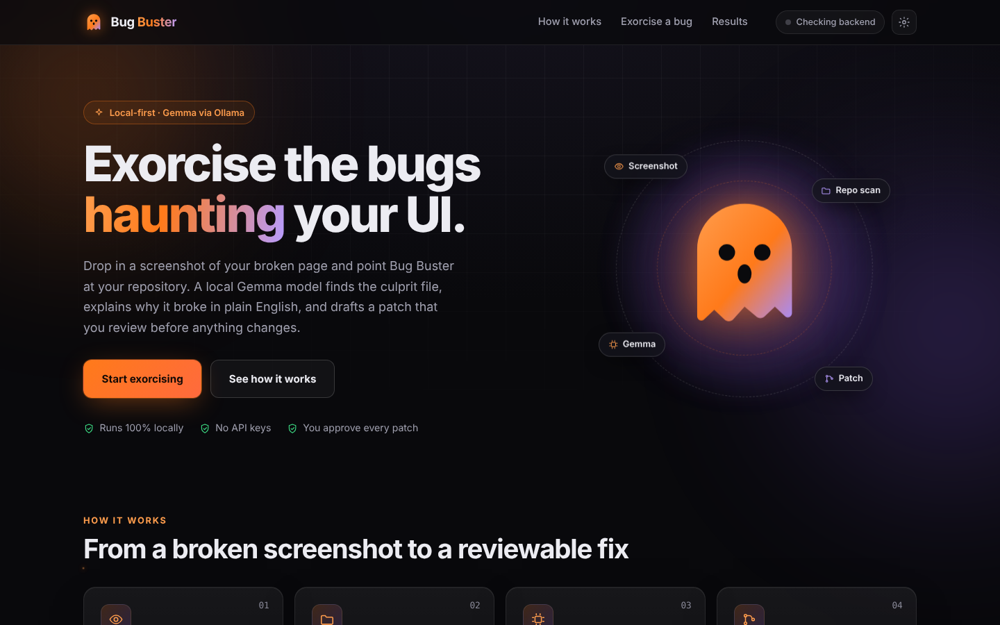
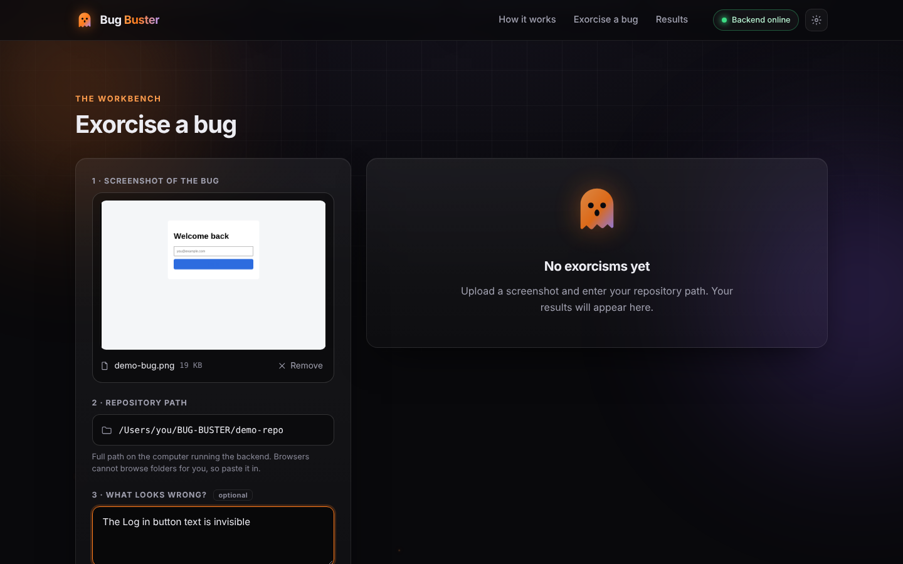

# 🐛 Bug Buster





**Open-source visual bug-to-patch engine.** Drop in a screenshot of a bug and point at your local repo. A local open-weight AI model finds the culprit file, explains the root cause, and hands you a Git diff plus the fixed code.

Built for **Halloween Hack BLR · DevF8rge × Hacktoberfest 2026** · Theme: *AI for Open Source* / *Developer Productivity*.

## What it does

1. You upload a screenshot of the bug, enter the path to your local repo, and optionally add a hint.
2. The backend scans the repo safely (no secrets, no binaries, no symlinks, size limits).
3. **Gemma** (running locally through Ollama) reads the screenshot, then the relevant source files.
4. You get back: the **culprit file**, the **root cause**, a **Git diff**, and the **fixed code**.
5. The diff is checked against your real files. **Patches are never applied automatically**; you review and apply them yourself.

Everything runs on your machine. **No cloud AI, no paid APIs, no API keys.**

## Open models used

| Model | Role | Runs via |
|-------|------|----------|
| [Gemma 3 4B](https://ai.google.dev/gemma) (`gemma3:4b`, vision) | Screenshot understanding and code analysis | [Ollama](https://ollama.com), locally |

## AI tools used to build this project

Per the hackathon rules, we disclose AI assistance:

- **Claude (Anthropic)** assisted in writing and reviewing code and documentation. Every team member is expected to be able to explain the code in this repo.
- **Gemma 3** (above) is the AI engine inside the product itself.

## Quick start

You need [Python 3.10+](https://www.python.org) and [Ollama](https://ollama.com).

**Windows:** double-click `start.bat`
**macOS / Linux:** `chmod +x start.sh && ./start.sh`

http://localhost:5500/exp.html and http://localhost:5500 with http://localhost:8000

### Manual setup

```bash
# 1. Model
ollama pull gemma3:4b

# 2. Backend
cd backend
python -m venv .venv
# Windows: .venv\Scripts\activate    macOS/Linux: source .venv/bin/activate
pip install -r requirements.txt
cp .env.example .env        # Windows: copy .env.example .env
uvicorn main:app --host 127.0.0.1 --port 8000

# 3. Frontend (new terminal)
cd frontend
python -m http.server 5500
```

http://localhost:5500/exp.html and http://localhost:5500 with http://localhost:8000
## Try the demo

`demo-repo/` contains a tiny login page with a deliberate bug: the login button's text colour equals its background colour, so the label is invisible.

1. Open `demo-repo/index.html` in a browser and screenshot the page.
2. In Bug Buster, upload the screenshot and enter the full path to `demo-repo`.
3. Click **EXORCISE BUG**.

## API

| Method | Path | Purpose |
|--------|------|---------|
| GET | `/health` | Backend and Ollama status |
| POST | `/analyze-bug` | multipart: `image`, `repo_path`, optional `issue_hint` |

`/analyze-bug` returns `culprit_file`, `root_cause`, `git_diff`, `fixed_code` (plus an `analysis` object with confidence and evidence).

## Project structure

```
BUG-BUSTER/
├── frontend/      exp.html, exp.css, script.js (vanilla, no build step)
├── backend/       FastAPI: main.py, scanner.py, gemma_engine.py, patch_validator.py
├── screenshots/   home-page.png, bug-upload.png (add result-page.png from your own real run)
├── demo-repo/     sample buggy site used for the demo
├── start.bat / start.sh   one-command launchers
├── README.md  CONTRIBUTING.md  LICENSE  .gitignore  requirements.txt
```

## Safety by design

- Repo paths are resolved safely; symlinks are not followed.
- `.env` files, secrets, lockfiles, minified and binary files are never read or sent to the model.
- Generated patches are validated (no traversal, no deletions or renames) and **never auto-applied**.
- CORS is limited to exact local origins.

## Credits

- [Gemma](https://ai.google.dev/gemma) by Google DeepMind (model weights under the Gemma terms of use)
- [Ollama](https://ollama.com) (MIT) for local model serving
- [FastAPI](https://fastapi.tiangolo.com), [Uvicorn](https://www.uvicorn.org), [Pydantic](https://docs.pydantic.dev), [python-multipart](https://github.com/Kludex/python-multipart), [python-dotenv](https://github.com/theskumar/python-dotenv), [httpx](https://www.python-httpx.org)

## Contributing

See [CONTRIBUTING.md](CONTRIBUTING.md). Please follow the [MLH Code of Conduct](https://mlh.io/code-of-conduct).

## License

[MIT](LICENSE). Note that the Gemma model weights are governed by their own terms.
